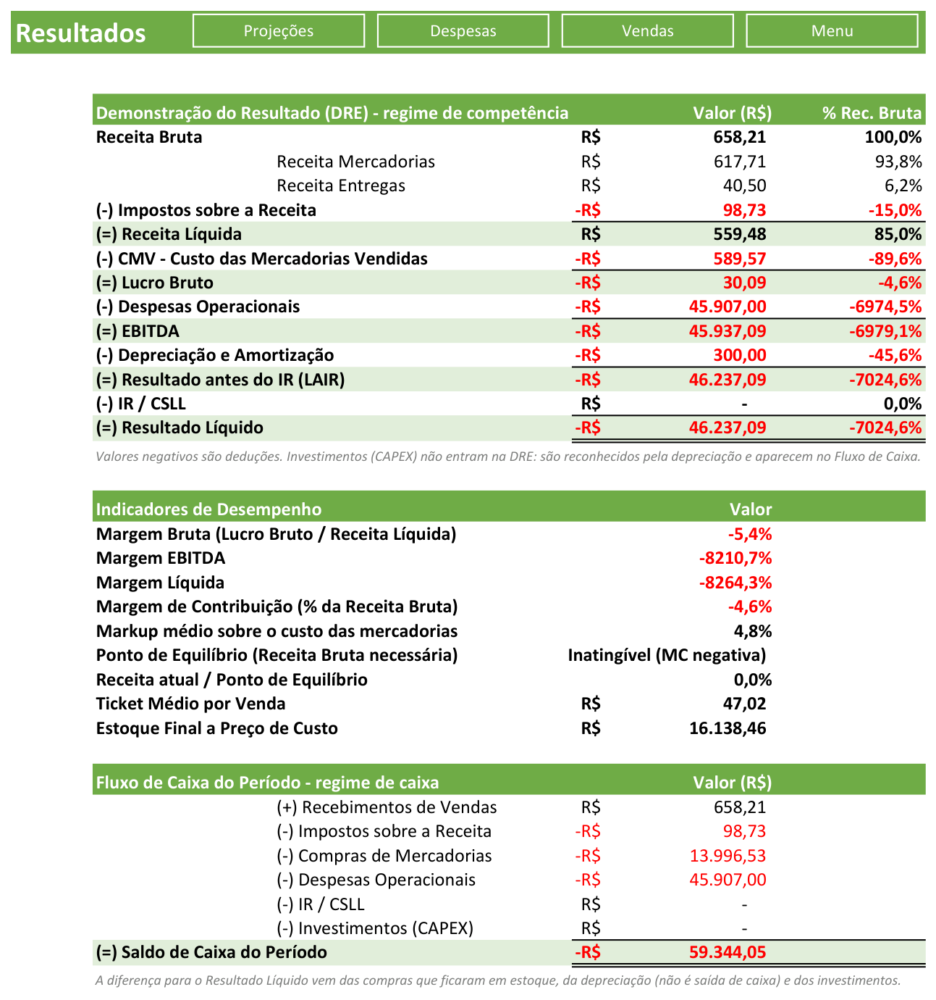
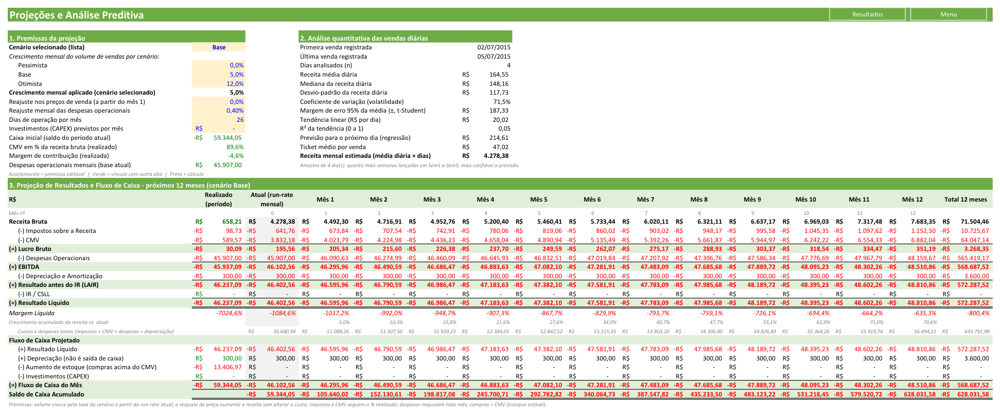
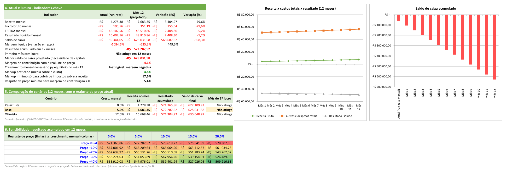
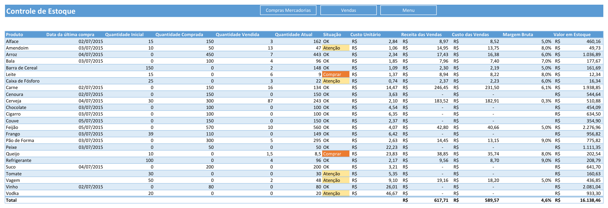

# Análise Financeira de Demonstrativos Internos em Excel

Pasta de trabalho Excel (`.xlsm`) de **controle e análise financeira de um pequeno mercado**: vendas semanais, compras, estoque, despesas e investimentos se consolidam em uma **DRE**, um **Fluxo de Caixa**, **indicadores de desempenho** e uma aba de **projeções preditivas com cenários e análise de sensibilidade**.

O projeto parte de uma planilha-base de um curso de Excel Avançado. Nesta versão, ela foi **auditada, corrigida e ampliada**, ganhando análise quantitativa e preditiva.

> 📂 Arquivo: [`Controle+Mercado_base.xlsm`](Controle+Mercado_base.xlsm). Abra no Excel (Windows/Mac) e **habilite as macros** para usar os botões de inserir/excluir vendas.

---

## Destaques

| Área | O que a planilha entrega |
|---|---|
| **DRE (regime de competência)** | Receita bruta → impostos → receita líquida → **CMV** → lucro bruto → despesas → **EBITDA** → depreciação → LAIR → IR/CSLL → resultado líquido, com **análise vertical (% da receita)** |
| **Fluxo de Caixa (regime de caixa)** | Recebimentos, impostos, compras, despesas, IR e CAPEX, com a explicação da diferença entre resultado e caixa |
| **Indicadores** | Margem bruta, EBITDA e líquida, margem de contribuição, markup, **ponto de equilíbrio**, ticket médio e estoque a custo |
| **Análise quantitativa** | Média, mediana, desvio-padrão, coeficiente de variação, **intervalo de confiança 95% (t-Student)**, **regressão linear** (tendência, R², previsão) das vendas diárias |
| **Projeção 12 meses** | DRE e fluxo de caixa mês a mês, comparando **Realizado x Atual (run-rate) x Futuro** |
| **Cenários** | Pessimista / Base / Otimista escolhidos em lista suspensa, mais uma comparação lado a lado calculada com fórmulas fechadas (`SUMPRODUCT`) |
| **Sensibilidade** | Matriz *reajuste de preço × crescimento mensal* → resultado acumulado em 12 meses, com escala de cores |
| **Margem por produto** | Receita, custo das vendas, margem bruta e valor em estoque por item |

## Telas

### DRE, indicadores e fluxo de caixa

### Projeções: premissas, análise quantitativa e projeção de 12 meses

### Atual x Futuro, cenários, sensibilidade e gráficos

### Controle de estoque com margem por produto

---

## O que foi corrigido na planilha original

A auditoria encontrou erros que distorciam o resultado:

| # | Problema na versão original | Correção |
|---|---|---|
| 1 | **CMV = total comprado no período** (R$ 13.996). A mercadoria que ainda estava em estoque era tratada como custo | CMV = custo de compra × **quantidade vendida** (R$ 589,57), calculado por produto no Controle de Estoque |
| 2 | Nas abas de vendas (Sem1–Sem5), o **"Preço Unitário" buscava o preço de *compra*** (coluna 2), e não o de venda | `PROCV` passou a usar a coluna 3 (*Preço de Venda Unitário*). A receita subiu de R$ 616,10 para R$ 658,21 e as tabelas dinâmicas foram atualizadas |
| 3 | O % de vendas com entrega (`Vendas!D25`) **contava a Semana 3 duas vezes** | Termo duplicado removido |
| 4 | Investimentos (CAPEX) eram **descontados do resultado** | Saíram da DRE: o CAPEX é reconhecido pela depreciação e aparece no Fluxo de Caixa |
| 5 | Alíquotas e valores **fixos dentro das fórmulas** (15%, 30%, isenção de R$ 1.000, depreciação de R$ 300, níveis de estoque 50/20) | Viraram **premissas nomeadas** (`Aliq_Imposto_Receita`, `Aliq_IR`, `Isencao_IR`, `Depreciacao_Mensal`, `Estoque_Atencao`, `Estoque_Comprar`) em `cálculos › Parâmetros Financeiros` |
| 6 | O comentário do IR falava em 25%, mas a fórmula usava 30% | Mantido 30% (comportamento original) e documentado no próprio parâmetro |
| 7 | O botão **"Compras Mercadorias" do Menu abria a aba Vendas** | Link corrigido |
| 8 | Botões duplicados e sobrepostos em Sem4/Sem5 | Duplicatas removidas |
| 9 | Ticket médio e % de entregas davam erro de divisão por zero sem vendas | Protegidos com `SEERRO` |

O primeiro commit do repositório guarda a **versão original**, para comparar antes e depois.

## Principais achados da análise (dados de exemplo)

- **O preço não cobre os impostos.** O markup médio praticado é de **4,8%**, mas só os 15% de impostos sobre a receita exigem um markup mínimo de **17,6%**. Resultado: a **margem de contribuição é negativa (-4,6%)**, ou seja, cada venda dá prejuízo antes mesmo das despesas fixas.
- **Descontos zeram a margem do item mais vendido.** A cerveja (87 unidades) tem margem bruta de **0,3%**, porque o desconto de 5% consome quase todo o markup de 4,2%.
- **Crescer agrava o prejuízo enquanto a margem é negativa.** Na matriz de sensibilidade, com o preço atual, mais crescimento piora o resultado. Com reajuste a partir de ~5,4%, o crescimento passa a ajudar.
- **Escala insuficiente.** O run-rate de receita (≈ R$ 4,3 mil/mês) está muito abaixo das despesas fixas (≈ R$ 45,9 mil/mês). Nenhum cenário atinge o equilíbrio em 12 meses sem rever preço e estrutura de custos.

> ⚠️ Os dados são **fictícios** (planilha-base de curso, julho/2015) e cobrem apenas **4 dias de vendas**. A própria planilha mostra o tamanho da amostra e a margem de erro, e as projeções devem ser lidas como **demonstração do modelo**, não como previsão real.

## Técnicas de Excel utilizadas

- **Tabelas estruturadas** e referências estruturadas (`Tabela3[@[Quantidade Vendida]]`, `Tabela3[[#Totals],...]`)
- **Nomes definidos** para premissas e **validação de dados** (lista de cenários)
- `SOMARPRODUTO` com matrizes para projetar 12 meses em uma única fórmula (cenários e sensibilidade)
- `ÍNDICE`/`CORRESP` (incluindo `CORRESP(VERDADEIRO; ÍNDICE(intervalo>0;0);0)` para achar o primeiro mês com lucro), `SOMASE`, `CONT.SES`, `FREQUÊNCIA`, `PROCV`
- Estatística: `DESVPAD.A`, `MED`, `INV.T.BC`, `INCLINAÇÃO`, `RQUAD`, `PREVISÃO`
- **Formatação condicional** (negativos em vermelho, escala de 3 cores, destaque do cenário selecionado, situação do estoque)
- **Tabelas dinâmicas**, **gráficos** de linha/colunas (barras negativas invertidas), navegação por **hiperlinks**
- **VBA**: macros para inserir compra/produto, nova venda e excluir registro (código exportado em [`vba/`](vba))

## Estrutura das abas

| Aba | Conteúdo |
|---|---|
| `Menu` | Navegação para as áreas principais |
| `Despesas` | Despesas fixas do mês (aluguel, pessoal, utilidades, serviços…) |
| `Compras Mercadorias` | Compras por fornecedor, com desconto (macro *Inserir Compra*) |
| `Controle de Estoque` | Estoque inicial/comprado/vendido/atual, situação, **custo, receita, margem e valor em estoque por produto** |
| `Investimentos` | CAPEX (informática, equipamentos, estrutura) |
| `Resultados` | **DRE com análise vertical, indicadores e fluxo de caixa** |
| `Projeções` | **Premissas, análise quantitativa, projeção 12 meses, atual x futuro, cenários, sensibilidade, gráficos** |
| `Vendas` | Consolidação semanal, entregas, ticket médio e clientes por região |
| `Sem1` … `Sem5` | Lançamento de vendas por semana (macros *Inserir Produto*, *Nova Venda*, *Excluir Registro*) |
| `Análise Sem1/Sem2` | Tabelas dinâmicas por dia e região |
| `cálculos` | Tabelas de preços (compra/venda), fretes por região e **Parâmetros Financeiros** |

## Como usar

1. Abra `Controle+Mercado_base.xlsm` e clique em **Habilitar Conteúdo** (macros).
2. Lance as vendas nas abas `Sem1`–`Sem5`, as compras e as despesas. A DRE, o estoque e as projeções se atualizam sozinhos.
3. Em **Projeções › Premissas**, ajuste as células **azuis com fundo amarelo**: cenário, crescimento, reajuste de preço, reajuste de despesas, dias de operação e CAPEX.
4. Ajuste alíquotas, depreciação e níveis de estoque em **cálculos › Parâmetros Financeiros**.

Convenção de cores: **azul/amarelo** = premissa editável · **verde** = vínculo com outra aba · **preto** = cálculo.

## Créditos

- Planilha-base: material do curso de Excel Avançado (metadados e comentários originais de João Paulo de Lira).
- Auditoria, correções, DRE/fluxo de caixa reestruturados, análise quantitativa, projeções, cenários e sensibilidade: **Matheus Vinicius**.
